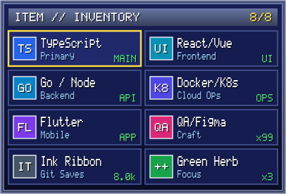
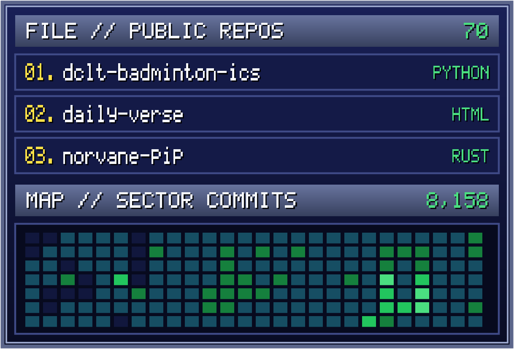

<!-- AUTO-GENERATED by scripts/generate-readme-svgs.mjs — edit the generator, not this file directly -->

  

  
  

  

  
  
  
  

  
📁 <strong>FILE // PUBLIC REPO ARCHIVE (70 total · last save 2026-11-28)</strong>

 

| # | File | Lang | ★ | Saved | Notes |
| :-: | :--- | :-: | :-: | :-: | :--- |
| `01` | [**dclt-badminton-ics**](https://github.com/mike623/dclt-badminton-ics) | `Python` | 1 | `2026-11-28` | — |
| `02` | [**daily-verse**](https://github.com/mike623/daily-verse) | `HTML` | 0 | `2026-11-27` | Daily bilingual Bible verse & reflection (EN + zh-TW) |
| `03` | [**norvane-pip**](https://github.com/mike623/norvane-pip) | `Rust` | 0 | `2026-11-24` | Cross-platform Tauri v2 Picture-in-Picture desktop wrapper for Norvane.. |
| `04` | [**scottish-tartan-finder**](https://github.com/mike623/scottish-tartan-finder) | `HTML` | 0 | `2026-11-23` | Unofficial static Scottish tartan finder concept: PRD, Astro scaffold,.. |
| `05` | [**kanagawa-orca-theme**](https://github.com/mike623/kanagawa-orca-theme) | `Python` | 0 | `2026-11-17` | Kanagawa Wave, Dragon and Lotus themes for Orca |

